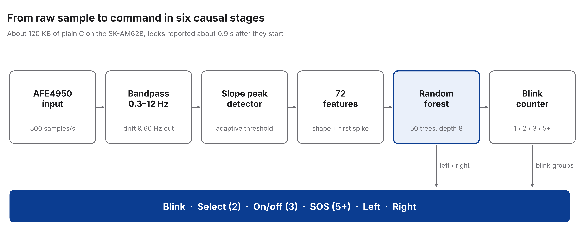

# BlinkTalk

**Talk, text and call for help with your eyes.** Glance left or right to move, blink twice to choose,
three times to switch BlinkTalk on or off, five times to call for help.

People with ALS, locked-in syndrome or a severe stroke often understand everything and can say nothing.
BlinkTalk reads eye movements from three electrodes on the face, recognises commands on a TI SK-AM62B
board, and turns them into speech, iMessages and SOS alerts. Family can follow the conversation live and
get alerted from anywhere.



## How it works

```
 electrodes ─► AFE4950EVM ─USB─► SK-AM62B: blinktalk_board.py + C eye-command model (offline)
                                     │ serial console
                                     ▼
 iMessage ◄─► Photon ◄─► hub ◄──WebSocket──► SpacetimeDB ◄──WebSocket──► patient screen (browser)
                          │                  (state + rules)   ◄──WebSocket──► caregiver dashboard
                          └─► AI model (Azure AI Foundry, or a local model)
```

1. **The patient glances and blinks.** The SK-AM62B filters the eye signal, finds each eye movement and
   classifies it with a 50-tree random forest written in plain C (about 120 KB, no dependencies). Left and
   right move the highlight, 2 blinks select, 3 blinks switch BlinkTalk on or off (so the patient can rest
   their eyes) and 5 blinks are SOS. Single blinks and groups of four are ignored. It also measures heart
   rate from a fingertip PPG sensor.
2. **The hub runs the board.** It opens the board's serial console, logs in, starts the eye-command model
   and forwards every command and heart-rate reading to SpacetimeDB. Nothing to click on the board.
3. **Every letter is live.** The patient screen is an eyes-only speller with word and phrase suggestions.
   The caregiver dashboard shows the words appearing as they are chosen, plus eye activity and heart rate.
4. **Someone texts the patient.** Photon delivers the iMessage, and the AI agent reads the conversation and
   the patient's live state and puts four replies, written in the patient's voice, on their screen. One
   double blink sends one back. The patient can also spell a few keywords ("alex pho") and pick **AI expand**
   for ready-to-send messages addressed to the right person. Nothing is ever sent without the patient's own
   selection.
5. **The patient blinks five times.** SpacetimeDB raises an SOS and Photon texts tier-1 caregivers. If nobody
   replies "OK" within 45 s it escalates to tier 2, then tier 3. When someone answers, the patient's screen
   says help is coming. Heart rate out of range for 10 s raises the same kind of alert.
6. **Family catches up.** **Catch me up** on the dashboard writes a short handoff note from the last 3-24
   hours: conversations, alerts and how fast they were answered, and heart rate.

## Results

Measured with the C recognizer that runs on the board, on recordings it was never trained on
(`python training/evaluate.py` reproduces these):

| Test | Result |
|---|---|
| Random cued and self-paced command sequences (67 commands) | **63 / 67 recognised (94%)** |
| Rest, chewing, scrolling a phone (3.8 min) | **0 false commands** |
| Ordinary blinking with no command meant (1 min) | 7 false "select" (double blinks), no false on/off or SOS |
| Latency | looks ~0.9 s after the movement; blink commands ~2 s after the last blink |
| Footprint on the AM62B | ~120 KB of model tables, ~200 KB of state, no heap allocation |

How the model is trained and tested, with the per-recording numbers: [training/README.md](training/README.md).
All the recordings are in [data/](data).

## Repository

| Path | What it is |
|---|---|
| [`board/`](board) | Runs on the SK-AM62B: `blinktalk_board.py` (the board program), `afe4950.py` (EVM reader and recorder), `heart_rate.py`, `eog/` (the C eye-command recognizer and model) |
| [`hub/`](hub) | Node service on the laptop: board link (`board.ts`), Photon iMessage bridge (`photon.ts`), AI agent (`agent.ts`, `llm.ts`), caregiver briefings (`briefing.ts`) |
| [`spacetime/`](spacetime) | The backend: one SpacetimeDB module with every table and rule (validation, phrase learning, heart-rate alerts, SOS escalation) |
| [`bindings/`](bindings) | Typed client bindings for the module |
| [`dashboard/`](dashboard) | React + Vite: the eyes-only patient screen and the caregiver dashboard |
| [`training/`](training) | Rebuilds the eye-command model from the recordings and tests it end to end |
| [`data/`](data) | Every recording used for training and testing, with a manifest |
| [`docs/`](docs) | [Board setup](docs/BOARD_SETUP.md) and figures |
| [`scripts/`](scripts) | `npm start` launcher, end-to-end test, AI and Photon checks, serial port list, secret scanner |
| [`deploy/`](deploy) | Container for an always-on hub + dashboard |

## Requirements

| What | Version | Used for |
|---|---|---|
| [Node.js](https://nodejs.org) | 22 or newer | hub, screens, tests |
| [SpacetimeDB CLI](https://spacetimedb.com/install) | 2.x | the backend database |
| Python | 3.10 or newer | only for training the model (`training/`) and running board tests on a PC |
| Hardware (optional) | TI SK-AM62B, TI AFE4950EVM, 3 gel electrodes, PPG finger sensor | live eye commands; without it the keyboard stands in for the eyes |

Optional accounts: an AI model endpoint (Azure AI Foundry, or a local model through Ollama) for reply
drafts and briefings, and [Photon](https://app.beta.photon.codes) for a real iMessage line. Without them
BlinkTalk uses built-in replies and simulated texting.

## Install

```powershell
git clone https://github.com/NealKapadia/BlinkTalk.git
cd BlinkTalk
npm install                                   # all JavaScript dependencies (npm workspaces)
iwr https://windows.spacetimedb.com -useb | iex   # SpacetimeDB CLI on Windows (macOS/Linux: curl -sSf https://install.spacetimedb.com | sh)
copy .env.example .env                        # then edit .env (macOS/Linux: cp .env.example .env)
```

In `.env` (every setting is explained in [.env.example](.env.example)):
- `BOARD_PORT`: the board's COM port, e.g. `COM12` (`npm run ports` lists them). Leave empty without a board.
- `AI_BASE_URL`, `AI_MODEL`, `AI_API_KEY`: your AI model. Check it with `npm run llm-check`.
- `PHOTON_PROJECT_ID`, `PHOTON_API_KEY`: the iMessage line (see [Photon setup](#photon-setup)).

The board needs its software copied once: [docs/BOARD_SETUP.md](docs/BOARD_SETUP.md).

## Run

```powershell
spacetime start                                               # terminal 1: the database (leave running)
cd spacetime; spacetime publish --server local -y blinktalk; cd ..   # once per fresh database
npm start                                                     # terminal 2: hub + screens
```

- Patient screen: http://localhost:5173/?view=patient (full screen with F11)
- Caregiver dashboard: http://localhost:5173

With the board plugged in, the hub log shows `[board] model running: model=eog_c ...` and eye commands
start moving the patient screen. Without a board, the keyboard stands in for the eyes on the patient
screen: arrows = glance, Space = 2 blinks, P = 3 blinks, S = SOS.

No database handy? `http://localhost:5173/?demo` and `http://localhost:5173/?view=patient&demo` run on
built-in sample data (`npm run dashboard` is enough).

### Photon setup

1. At app.beta.photon.codes, create an API key with `project:read` and `project:write`. Put it in `.env`
   as `PHOTON_API_KEY`, and the project id (`pho_prj_...`) as `PHOTON_PROJECT_ID`.
2. Under **iMessage > Add someone to the line**, add the phone number of everyone who should text the
   patient or get SOS alerts, and give each a number from the shared pool: that is the patient's BlinkTalk line.
3. Each person texts that line once (e.g. "hi"): a shared line can only reply to people who texted it first.
4. Add the same people under **Care circle** on the dashboard, with a tier, so SOS alerts reach them in order.
5. `npm run photon-check` confirms the key works and lists recent texts to the line.

### Local AI model (optional, works offline)

```powershell
ollama pull qwen3:8b
```
Then in `.env`: `AI_BASE_URL=http://localhost:11434/v1`, `AI_MODEL=qwen3:8b`, and no `AI_API_KEY`. Any
OpenAI-compatible server works the same way. With local SpacetimeDB and the on-board eye model, only
iMessage needs the internet.

### Family on other networks (SpacetimeDB Maincloud)

```powershell
spacetime login
cd spacetime; spacetime publish --server maincloud -y blinktalk; cd ..
```
Set `SPACETIME_URI=wss://maincloud.spacetimedb.com` in `.env` and open the dashboard with
`?uri=wss://maincloud.spacetimedb.com&db=blinktalk`. `deploy/Dockerfile` packages the hub and the screens for
any container host (`docker build -f deploy/Dockerfile -t blinktalk .`); run one hub at a time so each text is
answered once.

## Tests

```powershell
npm test                      # 47 tests: SpacetimeDB module (9), hub (31: board link, AI agent, briefings, Photon), patient screen (7)
npm run e2e                   # 20 end-to-end checks against a running SpacetimeDB (hub spawned, Photon simulated)
python board/test_board.py    # board program replaying recordings (Linux, WSL, or on the board)
python training/evaluate.py   # end-to-end accuracy of the eye-command model (needs gcc)
npm run llm-check             # live check of your AI model: text, tool calls, photos
npm run check-secrets         # scans tracked files for keys (node scripts/install-hooks.mjs adds it as a pre-commit hook)
```

## Limits and safety

BlinkTalk is a research prototype, not a medical device. The eye-command model was trained on one person
with one electrode placement; anyone else should be tested before relying on it (`data/` has recordings from
a second volunteer for this). Heart rate comes from a fingertip PPG sensor. SOS escalation depends on the
laptop, the network and Photon being up, so it does not replace a nurse-call system. The AI only drafts:
nothing is sent without the patient's own selection, except caregiver alerts.

Built by Neal Kapadia.
