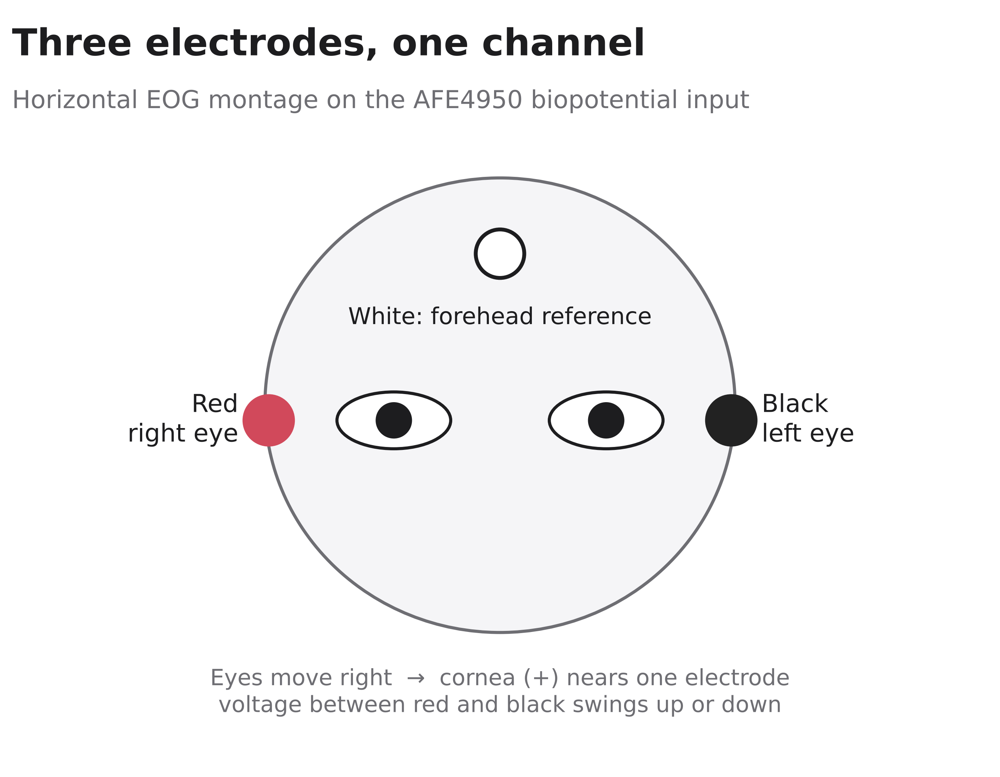
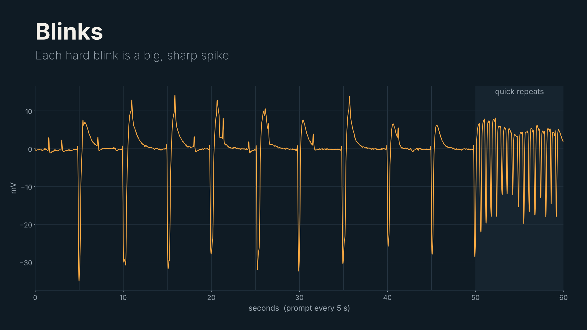
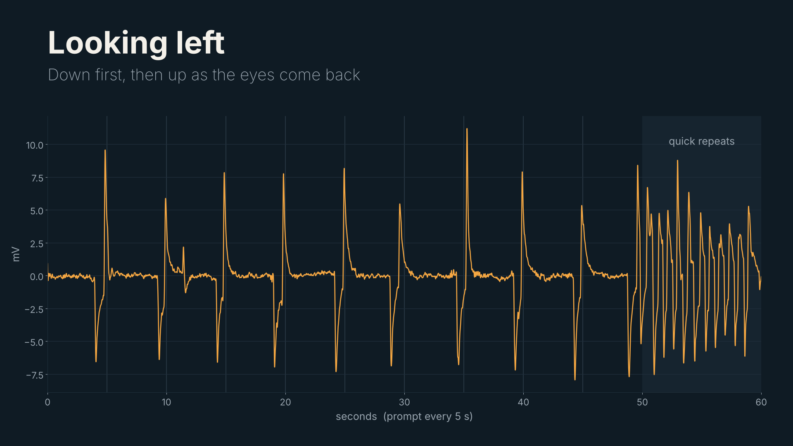
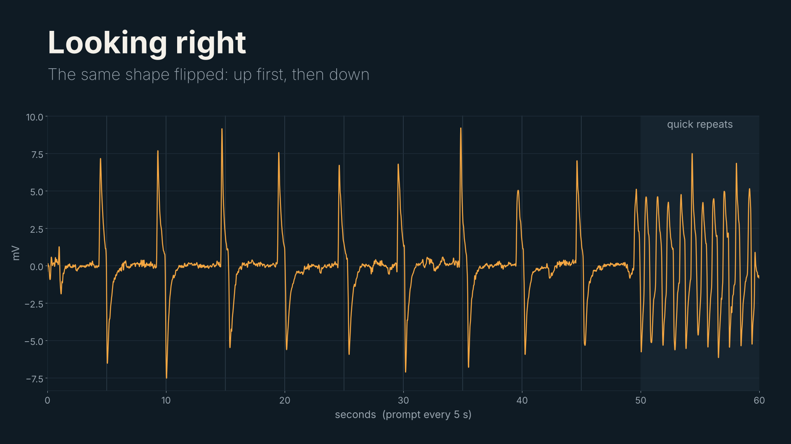

# BlinkTalk recordings

Every recording used to build and test the eye-command model. All of them are raw AFE4950 captures:
the biopotential (ECG) input wired as a horizontal EOG channel, 500 samples per second, 60 s each,
exported by TI's AFE4950 GUI (or recorded on the SK-AM62B with `board/afe4950.py`, same format).

```
x0000,y0000          header
0,8.697509766e-05,   time (s), signal (volts), GUI filtering off
0.002,3.490447998e-05,
```

[`recordings.csv`](recordings.csv) lists every file: who recorded it, the action in it, and how it is used.

## Electrode placement

Red beside the outer corner of the **right** eye, black beside the outer corner of the **left** eye, both at
pupil height; white (reference) in the middle of the forehead. With this placement a left look pushes the
signal up, and a right look or a blink pushes it down (the blink is a short dip that comes straight back).



## What is here

| Group | Files | Used for |
|---|---|---|
| **Command recordings** (Neal) | `neal_{blink,left,right}_every_{1s,3s,5s}*.csv`, `neal_right_rapid.csv` (16 files) | Training. Each has one action repeated on a schedule (every 1, 3 or 5 s); some end with 10 s of fast repeats. The schedule is how events are labeled (`training/dataset.py`). |
| **Controls** (Neal) | `neal_rest_looking_up*.csv`, `neal_chewing.csv`, `neal_scrolling_phone.csv` | Training as "no command", and measuring false commands. |
| **Natural blinking** (Neal) | `neal_natural_blinking.csv` | Test only: 60 s of ordinary blinking with no command meant. |
| **Random sequences** (Neal) | `neal_random_sequence_{1,2,3}.csv`, `neal_self_paced_sequence.csv` | Test only, never trained on. The cues are in [`sequences/`](sequences): the prompter (`training/prompter.html`) showed 16 random commands at the times in `random_sequence_N_cues.csv`; the self-paced one follows the order in `self_paced_sequence_order.tsv`. |
| **Live board capture** | `neal_board_live_eog.csv`, `neal_board_live_ppg.csv` | A capture made on the SK-AM62B itself (eye channel + PPG for heart rate). |
| **Second volunteer** | `person1_*.csv` | Not used by the current model. Recorded with the electrodes mirrored (red beside the left eye), so left and right are swapped. Kept to test how well the model transfers to another person. |

Cue codes in `sequences/`: `b` one blink, `s` two quick blinks (select), `l` look left, `r` look right,
`sos` three quick blinks. These sequences were recorded when three blinks meant SOS; today three blinks
switch BlinkTalk on/off and SOS is five or more, so `training/evaluate.py` scores a cued `sos` against the
on/off command. The number after each command in `self_paced_sequence_order.tsv` was noted during the
recording and is not used for scoring (only the order is).

## Waveforms

| Blink | Look left | Look right |
|---|---|---|
|  |  |  |

More figures (signal shapes, pipeline, accuracy, a random sequence) are in [`docs/figures`](../docs/figures).

## Recording more

On the board: `python3 afe4950.py --seconds 60 --cue left --out recordings/alex_left_every_5s` prints a
prompt every 5 s and fast repeats from 50 s. Copy the `_ECG.csv` file here, add a row to `recordings.csv`
(the go sign is -1 for blink and right, +1 for left with the standard placement) and run
`python training/train_model.py`.
