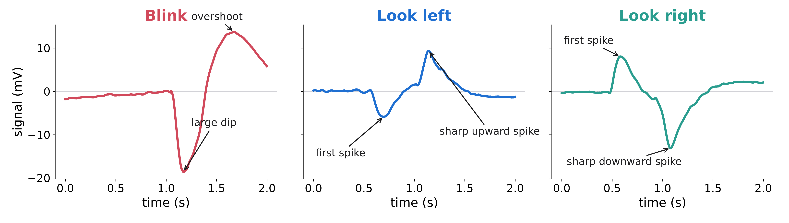

# Training the eye-command model

The board runs a random forest written out as C tables (`board/eog/eog_model.h`). This folder rebuilds it
from the recordings in [`data/`](../data) and tests it with the same C code the SK-AM62B runs.

```
python -m pip install -r training/requirements.txt     # numpy, scipy, scikit-learn
python training/train_model.py                          # about 15 s
python training/evaluate.py                             # test the model that is on the board now
```

Needs Python 3.10+ and `gcc` (Linux, macOS, or WSL on Windows): the C feature extractor and recognizer
are compiled into `training/build/` on first use.

## How it works

| Step | File | What happens |
|---|---|---|
| 1. Features | `eog_features.c`, `dataset.py` | Runs the board's unmodified recognizer (`board/eog/eog.c`) over each recording with events switched off, and copies out the 72 features it computes at every trigger. Training therefore sees exactly the numbers the board will compute. |
| 2. Labels | `dataset.py` | Each command recording holds one action on a schedule. Its onsets are the strongest slope peaks in the action's direction; the trigger at each onset gets the action's label, other triggers within 0.4 s are left out (eyes returning, blink bounce), the rest are "none". Control recordings are all "none". |
| 3. Model | `train_model.py` | Random forest, 50 trees, depth 8, balanced class weights, on the `train` and `control` rows of `data/recordings.csv`. |
| 4. Export | `export_model.py` | Writes `output/eog_model.h` (node tables + leaf probabilities) and checks the C-style tree walk against scikit-learn (difference ~1e-16). |
| 5. Test | `evaluate.py` | Compiles the header into the real recognizer and replays recordings never used for training: 3 random cued sequences, 1 self-paced sequence, and ordinary blinking. Also counts false commands in the controls. |

The 72 features (see `features()` in `board/eog/eog.c`), computed around each slope peak:
17 shape features (direction, slope and peak size relative to the noise, quick reversal = blink,
slope half-width, levels after the edge), 4 "first spike" features (a look begins with a small movement
the opposite way 0.4-0.7 s before the sharp edge; a blink does not), 50 waveform samples from 0.2 s before
to 0.8 s after, normalised, and the log amplitude.



## Results

`python training/train_model.py` prints all of these. On the current data:

| Test | New model (`output/eog_model.h`) | Model on the board |
|---|---|---|
| Leave-one-recording-out, 492 commands in 16 recordings (event level) | 88% | (trained on all of them) |
| Random cued + self-paced sequences, never trained on (end to end) | 66 / 67 commands | 63 / 67 commands |
| False commands in 4.8 min of no-command recordings | 7 | 7 |

The leave-one-recording-out score is held back by the two 5-second look recordings and one blink recording
from an earlier session: their signal shapes differ from the rest, and a model that has not seen that
session misses some of them. The other 13 recordings score 79-100% (10 of them 95% or more).

All of the false commands are double blinks read as "select" in the 60 s of ordinary blinking (never
trained on): blinking twice quickly without meaning to. Single blinks are never commands.

## Putting a new model on the board

```
python training/train_model.py --install      # copies output/eog_model.h to board/eog/
```
Then copy `board/eog/` to the board and rebuild the library there:
`cd /root/blinktalk/eog && gcc -O2 -shared -fPIC -o libeog.so eog.c eog_api.c -lm`
(the board uses `libeog.so` before the prebuilt `libeog_aarch64.so`). Run `python3 test_board.py` on the
board to check it.

## Recording more data

`prompter.html` (open it in a browser) shows random commands with a beep, for recording test sequences.
For training recordings, `python3 afe4950.py --seconds 60 --cue blink --out recordings/<name>` on the board
prompts one action every 5 s. Add each new file to `data/recordings.csv` and retrain.
